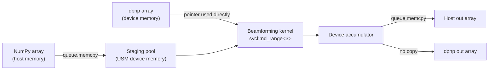

# The CUDA to SYCL / oneAPI port

mach carries two beamforming backends behind one Python API: the original CUDA kernel in
[`src/mach/kernel.cu`](src/mach/kernel.cu) and a SYCL port in
[`src/mach/kernel_sycl.cpp`](src/mach/kernel_sycl.cpp) targeting Intel GPUs through Level Zero
with an OpenCL CPU fallback. Only one is compiled at a time, into separate build trees, and
`mach._backend` selects whichever is present at import.

This document covers how the two APIs map onto each other, what was optimized on the way
across, and how to read the benchmark suite for a sonography workload.

> **Note**: every quantity in this document is derived from the source, not measured. The SYCL
> backend has been verified correct on the CPU device via the plane-wave compounding example, but
> it has not yet been run on an Intel GPU and no SYCL benchmark results have been collected.
> Measured CUDA numbers live in [BENCHMARKS.md](BENCHMARKS.md).

## Contents

- [Direct API translation](#direct-api-translation)
- [Package and toolchain equivalents](#package-and-toolchain-equivalents)
- [Four places the mapping is not one to one](#four-places-the-mapping-is-not-one-to-one)
- [Throughput optimizations](#throughput-optimizations)
- [Where the per-frame time goes](#where-the-per-frame-time-goes)
- [What this buys an ultrasound system](#what-this-buys-an-ultrasound-system)
- [The benchmark suite](#the-benchmark-suite)
- [How to read the results for your own system](#how-to-read-the-results-for-your-own-system)
- [Running the benchmarks](#running-the-benchmarks)

## Direct API translation

Most of the kernel translated construct for construct. The tables below are the complete mapping
actually used in the port, not a generic cheat sheet.

### Kernel-level constructs

| CUDA | SYCL / oneAPI | Note |
|------|---------------|------|
| `__global__ void beamformKernel(...)` | `cgh.parallel_for<BeamformKernel<...>>(nd_range<3>, ...)` | Kernel identity comes from a template tag type rather than a function symbol |
| `__device__ __forceinline__` | plain `inline` | One translation unit is compiled for both host and device |
| `dim3 grid, dim3 block` | `sycl::nd_range<3>(global_range, local_range)` | The global range is total work-items, not a block count |
| `threadIdx.x` / `threadIdx.y` | `item.get_local_id(2)` / `item.get_local_id(1)` | Dimension order reverses |
| `blockIdx.x` / `.y` / `.z` | `item.get_group(2)` / `(1)` / `(0)` | Same reversal |
| `gridDim.x` | `item.get_group_range(2)` | Used to fold the two-dimensional voxel batch index |
| `static __shared__ float2 buf[N]` | `sycl::local_accessor<Float2, 1>` | Declared in the command group, sized at submit time instead of compile time |
| `__syncthreads()` | `sycl::group_barrier(item.get_group())` | Every work-item in the group must reach it |
| `atomicAdd(&p, v)` | `sycl::atomic_ref<float, memory_order::relaxed, memory_scope::device, address_space::global_space>` | Memory order and scope become explicit |
| `__sincosf(x, &c)` | `sycl::sincos(x, address_space_cast<generic_space, decorated::no>(&c))` | Wrapped as `mach::sincos` in `sycl_math.hpp` |
| `__float2uint_rn` / `_rd` / `_ru` | `sycl::rint` / `sycl::floor` / `sycl::ceil` | Wrapped as `mach::float_to_uint_*` in `sycl_math.hpp` |
| `sqrtf`, `fminf` | `sycl::sqrt`, `sycl::min` | Overloaded for device and host |
| `float3` and `helper_math.h` | `mach::Float3` in `sycl_math.hpp` | `sycl::float3` is padded to 16 bytes and cannot alias packed `(N, 3)` arrays |

### Host and runtime constructs

| CUDA | SYCL / oneAPI | Note |
|------|---------------|------|
| `thrust::device_allocator`, `allocate_unique` | `sycl::malloc_device` / `sycl::free` (USM) | Held in a pooled `StagingBuffer` instead of freed at scope exit |
| `cudaMemcpy(..., cudaMemcpyHostToDevice)` | `queue.memcpy(...)` | Enqueued on the queue rather than issued against a device |
| `cudaMemset` | `queue.memset(...)` | Zeroes the accumulator before the first transmit |
| `cudaDeviceSynchronize()` | `queue.wait_and_throw()` | Called once per entry point, not once per kernel |
| implicit default-stream ordering | `sycl::property::queue::in_order` | Out-of-order is the SYCL default, so ordering has to be requested |
| `checkCudaErrors(...)` | `catch (sycl::exception&)` rethrown as `std::runtime_error` | Plus an async handler for errors that surface at the next wait |
| `cudaSetDevice`, CUDA context | `sycl::device(gpu_selector_v)` and `sycl::context` | A context can be adopted from another library at runtime |
| DLPack `kDLCUDA` (device type 2) | DLPack `kDLOneAPI` (device type 14) | `nb::device::oneapi` in the nanobind signatures |
| CuPy | dpnp | dpctl 0.22 removed `dpctl.tensor` and moved tensor functionality into dpnp |

## Package and toolchain equivalents

Limited to the pieces that matter for the optimizations below and for running the benchmarks.
One mapping is worth stating explicitly because it is commonly muddled: DPC++ is the counterpart
of CUDA C++, the language and compiler, while CuPy's counterpart is **dpnp**. dpctl sits under
dpnp as the device and queue layer, roughly where `cupy.cuda` sits under CuPy.

### Toolchain and runtime

| CUDA / NVIDIA | oneAPI / Intel | Role in mach |
|---------------|----------------|--------------|
| CUDA Toolkit, `nvcc` | Intel oneAPI DPC++/C++ Compiler, `icpx -fsycl` | Compiles the kernel. `make compile-sycl` requires icpx 2026.0 or newer |
| PTX, lowered to SASS at load | SPIR-V, lowered to device code at load | `MACH_SYCL_TARGETS=spir64` keeps the JIT path, so one binary serves both GPU and CPU |
| `-arch=sm_90`, `CMAKE_CUDA_ARCHITECTURES` | `-fsycl-targets=spir64_gen` plus `-Xs "-device pvc"` | `MACH_SYCL_TARGETS` and `MACH_SYCL_AOT_FLAGS` for ahead-of-time builds |
| CUDA Runtime, `libcudart` | SYCL runtime, `libsycl` | The library mach and dpnp have to share, which is what the ABI guard checks |
| CUDA driver, `libcuda` | Level Zero `libze_loader` on GPU, OpenCL on CPU | Selected by `MACH_SYCL_DEVICE` |
| `nvidia-smi`, `deviceQuery` | `sycl-ls`, `clinfo` | Confirming a host or container can actually reach a device |
| Nsight Compute, Nsight Systems | Intel VTune Profiler, Intel Advisor | Kernel profiling. `MACH_SYCL_PROFILE` gives per-section timings without either |

### Device memory and algorithms

These are the libraries the optimizations in this document are built on.

| CUDA / NVIDIA | oneAPI / Intel | Role in mach |
|---------------|----------------|--------------|
| Thrust (`device_allocator`, `allocate_unique`) | SYCL USM (`sycl::malloc_device`), with oneDPL for the algorithm layer | The staging pool. mach needs only USM; oneDPL ships with the compiler package |
| CUB block and warp primitives | SYCL group algorithms (`group_barrier`, `atomic_ref`) | The shared delay and apodization table, and the output accumulation |
| cuBLAS, cuFFT, cuSOLVER, cuRAND | oneMKL (`onemkl-sycl-blas`, `-dft`, `-lapack`, `-rng`) | Not used by mach directly, but dpnp depends on all of them, which is most of what makes the `sycl-array` group large |

### Python packages

| CUDA / NVIDIA | oneAPI / Intel | Role in mach |
|---------------|----------------|--------------|
| CuPy | dpnp | Device arrays. `mach._backend.device_namespace()` returns whichever matches the active backend |
| `cupy.cuda.Device`, `cupy.cuda.Stream` | `dpctl.SyclDevice`, `dpctl.SyclQueue` | `adopt_sycl_queue()` takes a `SyclQueue` from dpnp so mach can join its context |
| `cupy-cuda12x` wheels, carrying the matching CUDA libraries | `dpcpp-cpp-rt` | The runtime wheel that has to match the compiler mach was built with |
| `jax[cuda12]` | `jax[oneapi]` | Only for the vbeam comparison benchmarks. jax aliases its `oneapi` platform to `gpu`, so `jax.devices("gpu")` finds Intel GPUs |
| `nvidia/cuda` Docker images | `intel-oneapi-compiler-dpcpp-cpp` from Intel's APT repo | [`Dockerfile.sycl`](Dockerfile.sycl) installs from APT because `intel/oneapi-basekit` has no 2026 tag yet |

mach's own hard requirements are short: an icpx of 2026.0 or newer to build, and the SYCL runtime
it links against at import. Everything else above is either optional (dpnp and dpctl, for
zero-copy device arrays) or pulled in transitively by those.

## Four places the mapping is not one to one

These are the differences that compile cleanly and still produce plausible-looking images when you
get them wrong, which makes them the expensive ones.

### 1. `nd_range` dimension order is reversed

SYCL's dimension 0 is the slowest varying and dimension 2 the fastest, the opposite of CUDA's
`dim3`. CUDA's `threadIdx.x` (frames) became `get_local_id(2)`, `threadIdx.y` (voxels) became
`get_local_id(1)`, and `blockIdx.z` (receive-element batches) became `get_group(0)`.

### 2. `sycl::float3` occupies 16 bytes

It is padded out to a `float4`, so it cannot alias the tightly packed `(N, 3)` float32 coordinate
arrays callers pass in. `sycl_math.hpp` defines a plain `mach::Float3` with a `static_assert`
pinning its size to 12 bytes:

```cpp
static_assert(sizeof(Float3) == 3 * sizeof(float),
              "Float3 must be tightly packed to alias (N, 3) float32 arrays");
```

### 3. Every work-item must reach the barrier

The CUDA kernel let out-of-range voxels return before `__syncthreads()`. That is undefined
behaviour which happens to work on NVIDIA hardware. The SYCL kernel guards the body with a
`voxel_in_range` flag and moves the early `return` to after `sycl::group_barrier`:

```cpp
// Every work-item in the group must reach the barrier below, so out-of-range
// voxels skip the body rather than returning early.
const bool voxel_in_range = voxel_idx < args.n_output_voxels;

if (voxel_in_range) {
    // ... populate the shared delay and apodization table
}
sycl::group_barrier(item.get_group());

if (!voxel_in_range) {
    return;
}
```

### 4. Queue ordering is opt-in

The CUDA code relied on the default stream serializing work. A SYCL queue is out-of-order unless
you ask, so mach builds its queue with `property::queue::in_order`. The compounding loop depends on
this: transmit k+1's upload is ordered after transmit k's kernel with no event tracking.

## Throughput optimizations

The port was the opportunity to fix structural overhead that the CUDA path also had. Everything
here lands on the NumPy path that all callers already use.

| Optimization | Before | SYCL implementation | Effect |
|--------------|--------|---------------------|--------|
| Pooled staging buffers | A thrust allocation per input, freed when the call returned | `StagingBuffer` keyed on the `sycl::context`, grown on demand and reused across calls | Takes device malloc and free off the steady-state path, which also removes their timing jitter |
| One synchronization per call | `cudaDeviceSynchronize()` inside the kernel helper | `_beamform_impl` returns a `sycl::event`, and the single `queue.wait_and_throw()` moved to the entry point with `QueueDrainGuard` covering the throw path | Copies and kernels queue up and the host blocks once at the end instead of round-tripping per kernel |
| Whole-sequence compounding | Callers looped `beamform()` once per transmit and summed on the host | `beamform_compound()` uploads the invariants once, reuses one channel-data scratch buffer and accumulates into one device output | Removes 15 of 16 synchronizations, 15 of 16 copy-backs and the entire host-side sum |
| Zero-copy device arrays | CuPy pointers were already usable directly | `adopt_sycl_queue()` rebuilds mach's queue on dpnp's `sycl::context` so dpnp USM pointers are valid inside mach's kernels | Eliminates host staging altogether when the caller keeps data on the device |
| In-order queue | The CUDA default stream serialized work implicitly | The queue is constructed with `property::queue::in_order` | Transmit k+1's upload is ordered after transmit k's kernel without tracking events |

## Where the per-frame time goes

A plane-wave compound frame is a sequence of transmits, not a single beamforming call. The three
layouts below are the same 16-transmit frame built three ways, with identical total kernel work in
each. Box widths illustrate structure, not measured timings.

```
Loop over beamform()                        setup, sync and copy back repeat per transmit
  ┌───────┬────────┬────────────┬───────────────┐
  │ setup │  H2D   │   kernel   │ sync + copy   │  ← repeats in full, 16 times
  └───────┴────────┴────────────┴───────────────┘

beamform_compound()                         invariants uploaded once, one sync at the end
  ┌───────┬────────┬────────────┬────────┬────────────┬ ─ ─ ─ ┬──────┐
  │ setup │  H2D   │   kernel   │  H2D   │   kernel   │       │ sync │
  └───────┴────────┴────────────┴────────┴────────────┴ ─ ─ ─ ┴──────┘
          └──────────────── 16 transmits ─────────────────────┘

beamform_compound() on dpnp arrays          channel data already in the shared SYCL context
  ┌────────────┬────────────┬ ─ ─ ─ ┬──────┐
  │   kernel   │   kernel   │       │ sync │
  └────────────┴────────────┴ ─ ─ ─ ┴──────┘
  └────────── 16 transmits ─────────┘
```

`setup` covers device allocation and the upload of receive coordinates, scan coordinates and
transmit arrival times.

### Which data path each input takes



The dpnp path only exists when mach managed to join dpnp's SYCL context at import. Check
`mach._backend.SHARES_DPCTL_CONTEXT`, and `DPCTL_ERROR` for the reason when it is `False`.

### The same comparison as exact counts

Derived from the code paths rather than measured, for one 16-transmit frame with host-resident
inputs. Device allocations are absent from every column because the staging pool serves all three.

| Work per frame | Loop over `beamform()` | `beamform_compound()` | compound + dpnp arrays |
|----------------|-----------------------:|----------------------:|-----------------------:|
| Host to device copies | 80 | 19 | 0 |
| Device to host copies | 16 | 1 | 0 |
| Output buffers zeroed | 16 | 1 | 1 |
| Host synchronizations | 16 | 1 | 1 |
| Host-side array additions | 15 | 0 | 0 |

## What this buys an ultrasound system

The stated priority for this project is high throughput, with latency protected but yielding if the
two ever conflict. The useful thing about the changes above is that they mostly do not conflict:
the overhead removed from the compounding path sat on the critical path of a single frame as well
as on the aggregate, so frames-per-second and time-to-first-image improve together.

### Why compounding is the right unit of work

In plane-wave or diverging-wave imaging, one displayed frame is the coherent sum of many transmits.
Exposing only a per-transmit entry point forced callers into a Python loop that synchronized,
copied back and summed on the host between every transmit, so a 16-angle sequence paid sixteen full
round trips to produce one image. `beamform_compound()` makes the sequence the unit: the host
enqueues all sixteen kernels back to back into an in-order queue and blocks exactly once. The
accumulator never leaves the device, and the host-side sum disappears entirely.

### Determinism matters as much as the mean

A real-time display runs at a fixed frame rate, so a frame that arrives late is a dropped frame
regardless of how good the average looks. Device allocation is the classic source of that kind of
tail: it is comparatively slow and its cost is unpredictable. Pooling the staging buffers converts
it into a one-time cost on the first call, which tightens the distribution rather than just
shifting its center. When reading the benchmarks, the spread is as informative as the mean for this
reason.

### The Doppler case is where transfer volume bites

Colour flow and power Doppler need an ensemble of frames per transmit, and channel data scales with
it directly. A 128-element probe at 1024 samples with a 16-frame ensemble is about 16.8 MB of
`complex64` per transmit, so a 16-transmit sequence moves roughly 268 MB across the host boundary
every frame. Keeping that data in dpnp arrays inside mach's adopted SYCL context removes the
transfer rather than accelerating it, which is why `scaling_frames` and `test_mach_from_cpu` are the
benchmarks to watch if Doppler is the target.

### The one real tradeoff

Deferring synchronization to the end of a call means the host does not learn about an asynchronous
device error until the whole sequence has been enqueued. mach handles this with an async exception
handler plus `throw_pending_async_error()` after the final wait, so nothing is lost, but the error
surfaces later than it would with a sync after every kernel. For a production imaging loop that is
the right trade; for debugging a new kernel, build with `MACH_SYCL_PROFILE`, which waits per kernel
and times each section.

## The benchmark suite

Two tiers. [`tests/test_backend_benchmark.py`](tests/test_backend_benchmark.py) is backend-agnostic
and runs on NumPy inputs against whichever backend is installed, so it works on a CPU-only SYCL
build. The suite under [`tests/compare/`](tests/compare) needs a device-array library and compares
against PyMUST and vbeam.

| Benchmark | File | What varies | What it isolates |
|-----------|------|-------------|------------------|
| `call_overhead` | `tests/test_backend_benchmark.py` | nanobind entry point vs Python wrapper, 1024 voxels | The fixed cost of a call: argument validation, normalization, launch and synchronization |
| `scaling_voxels` | `tests/test_backend_benchmark.py` | 4,096 to 262,144 voxels, 1 frame | Where the kernel starts to dominate the fixed per-call cost |
| `scaling_frames` | `tests/test_backend_benchmark.py` | 1, 4 and 16 frames at 16,384 voxels | Marginal cost of ensemble depth, which is the Doppler axis |
| `compounding` | `tests/test_backend_benchmark.py` | loop vs sequence, 16 transmits, 16k and 64k voxels | Exactly what `beamform_compound()` removes, at identical total kernel work |
| `scaling_voxels`, `scaling_receive_elements`, `scaling_ensemble_size` | `tests/compare/test_performance_scaling.py` | Grid resolution, element count multiplier, frame count multiplier | The same three axes but with device-resident inputs, so staging is out of the measurement |
| `test_mach` vs `test_mach_from_cpu` | `tests/compare/test_pymust.py` | Device-array input vs host-array input, same data | The host staging tax on its own |
| `test_pymust_benchmark`, `test_vbeam_benchmark` | `tests/compare/` | PyMUST sparse DAS matrix, vbeam JAX DAS | Third-party reference points for the same datasets |

## How to read the results for your own system

**Start with `call_overhead`, because it is your floor.** At 1024 voxels the kernel is negligible,
so that number is almost entirely fixed cost and no call can beat it. The gap between the
`nanobind` and `wrapper` rows is what the Python validation layer costs; if it is large relative to
your frame budget, call the compiled entry point directly.

**Find your knee on `scaling_voxels`.** Time that stays roughly flat from 4k to 16k voxels means
you are overhead-bound in that range and extra resolution is nearly free. The point where the curve
turns linear is where the kernel takes over. Locate your real grid on that curve before anything
else: a 128 by 512 B-mode grid is 65,536 voxels, the third point.

**`scaling_frames` is your Doppler ensemble budget.** Divide each result by its frame count to get
cost per frame. If that per-frame figure falls as the ensemble deepens, the fixed cost is being
amortized and a longer ensemble is cheap. If it stays flat you are transfer or compute bound, and
ensemble depth is a genuine linear cost to budget for.

**`compounding` is the headline comparison.** Both strategies do identical kernel work on identical
data, so the whole difference between `loop` and `sequence` is removed overhead. Invert the
`sequence` mean for a ceiling on compound frames per second at that grid size, ignoring
acquisition. Then read the standard deviation and the slowest round rather than the mean, since
those decide whether you hold a fixed display rate.

**`test_mach` against `test_mach_from_cpu` prices the transfer.** Same beamforming on the same
data, differing only in whether the input already lives on the device. That difference is your host
staging tax, and therefore the ceiling on what you would gain by restructuring an acquisition
pipeline to keep channel data in dpnp arrays. If it is small, zero-copy interop is not where your
time is going.

## Running the benchmarks

The SYCL backend requires an Intel oneAPI DPC++ compiler of 2026.0 or newer, because dpnp's wheels
bundle the 2026 SYCL runtime and mach passes a `sycl::queue` pointer across that boundary.

```bash
source /opt/intel/oneapi/setvars.sh

# Build the SYCL backend into build/sycl
make compile-sycl

# Add dpctl and dpnp, then report whether the SYCL context was shared
make install-sycl-array

# Full benchmark run with histograms
make benchmark-sycl

# Just the backend-agnostic tier, pinned to the GPU
MACH_SYCL_DEVICE=gpu uv run --no-sync pytest tests/test_backend_benchmark.py --benchmark-only
```

Set `MACH_SYCL_DEVICE` to `gpu`, `cpu` or `default` to choose the device.
